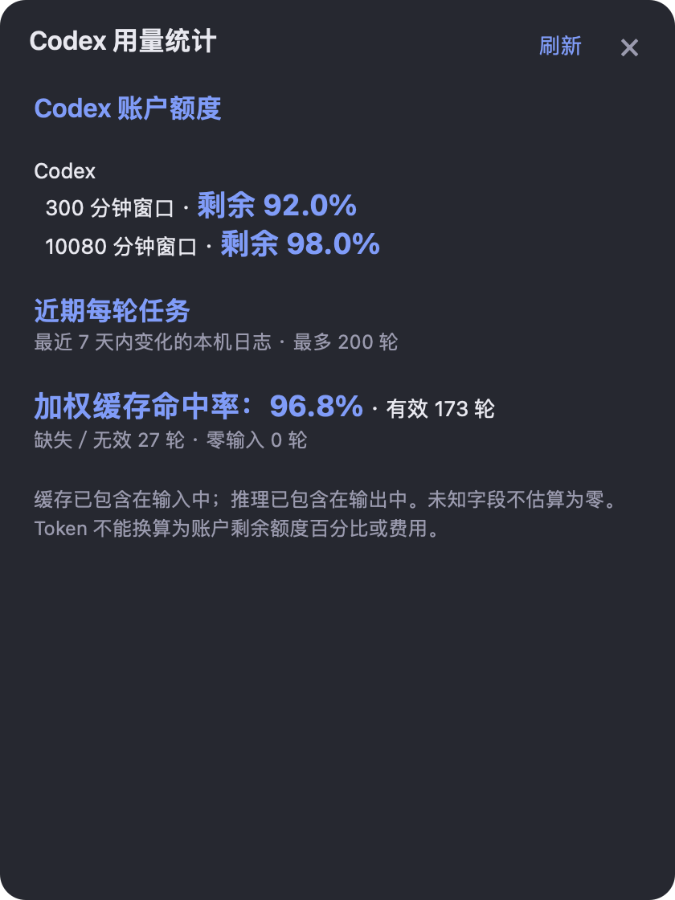

# Codex 用量统计 · macOS / Windows

蓝紫渐变悬浮球，随时查看 Codex 账户剩余额度、重置时间、每轮 Token 和缓存命中率。包含可直接运行的桌面程序、源码和 Codex skill。

社区项目，非 OpenAI 官方产品。

## 下载

前往 **[最新发布页](https://github.com/tangxia880-lab/codex-quota-monitor/releases/latest)** 下载对应系统的 ZIP：

| 系统 | 下载包 | 环境 |
| --- | --- | --- |
| macOS | `codex-quota-monitor-mac.zip` | macOS 12+、Python 3.8+、已登录的 Codex；附带 Intel App |
| Windows | `codex-quota-monitor-windows.zip` | Windows 10/11、.NET Framework 4.8、已登录的 Codex |

Apple Silicon 用户可使用 Rosetta 运行附带的 Intel App，或安装 Xcode Command Line Tools 后运行 Mac 包内的 `bash scripts/build.sh` 原生编译。


<details>
<summary>查看 Mac 深色详情面板（示例数据）</summary>



</details>

## 直接运行桌面程序

完整解压 ZIP 后：

- **Mac**：双击 `CodexQuotaMonitor.app`，或 `Start.command`。菜单栏 **CQ** 提供刷新、显示/隐藏、阈值、频率和退出。App 为本地临时签名，未经过 Apple 公证；若系统阻止打开，可通过系统设置的“隐私与安全性”确认打开。
- **Windows**：进入 `assets/CodexQuotaMonitor/`，双击 `CodexQuotaMonitor.exe` 或 `Start.cmd`。首次打开显示圆形悬浮球，右键可打开菜单或退出。

两个版本采用相同的蓝紫渐变 `#4D7CFE → #7A5CFF` 和深色详情配色。单击查看详情，拖动调整位置；Windows 另外保留贴边、任务完成通知和持久任务历史。

默认每 5 分钟刷新账户额度，低于或等于 20% 时提醒；Mac 的任务日志每 30 秒检查，Windows 每 5 秒检查。

## 安装为 Codex skill

把对应系统 ZIP 中的完整顶层文件夹放到 Codex 的 `skills` 目录。默认是：

- macOS：`~/.codex/skills/codex-quota-monitor-mac/`
- Windows：`%USERPROFILE%\.codex\skills\codex-quota-monitor-windows\`

如果设置了 `CODEX_HOME`，使用它下面的 `skills` 目录。确保 `SKILL.md` 直接位于上述文件夹内。安装后在下一轮 Codex 对话中使用：

```text
使用 $codex-quota-monitor-mac 打开监控
```

Windows 改为 `$codex-quota-monitor-windows`。

Mac 还支持单次命令查询：

```bash
python3 scripts/monitor.py quota
python3 scripts/monitor.py tasks
python3 scripts/monitor.py snapshot
```

## 统计口径

额度查询通过本机 Codex App Server，只读获取账户共享窗口的已用比例和重置时间，复用 Codex 的 ChatGPT 登录。没有提供的值显示未知。只使用 API Key 登录时可能没有订阅额度数据。

每轮任务用量从本机 Codex 日志读取。缓存命中已包含在输入 Token 中，推理已包含在输出 Token 中，不能重复相加。缓存汇总按有效输入量加权；未知、无效、零输入分别处理。父子轮次独立，复制历史按所有权过滤。

本工具不读取凭据文件、不创建模型任务、不购买额度、不消费重置券，也不把 Token 换算成某轮独占的订阅百分比或金额。

## 源码与验证

```text
skills/
  codex-quota-monitor-mac/       Swift/AppKit、Python 采集器和 Mac App
  codex-quota-monitor-windows/   skill 入口及 Windows 程序、C# 源码和测试
```

Mac：

```bash
cd skills/codex-quota-monitor-mac
python3 -m unittest discover -s tests -v
bash scripts/build.sh
```

Windows：

```powershell
cd skills/codex-quota-monitor-windows/assets/CodexQuotaMonitor
powershell -NoProfile -ExecutionPolicy Bypass -File .\build.ps1
powershell -NoProfile -ExecutionPolicy Bypass -File .\tests\Run-Tests.ps1
```

本次验证：Mac 采集逻辑 7 项测试通过，并完成真实额度查询与 App 启动检查；Windows EXE 已按 .NET Framework 4.8 交叉编译，7 个测试套件全部编译通过，3597 项纯定位和额度状态断言通过。Windows GUI、GDI+ 和系统通知尚未实机验证。Mac 迁移功能差异见 [迁移说明](skills/codex-quota-monitor-mac/MIGRATION.md)。

发布附件同时提供 SHA256 校验信息。

## 来源

Windows 版基于 [loverelic0-wq/codex-quota-monitor](https://github.com/loverelic0-wq/codex-quota-monitor) 的 CodexQuotaMonitor 1.0.0，增加蓝紫悬浮球与深色主题；Mac 版以 Swift/AppKit 和 Python 重新实现。保留上游项目来源与说明。
